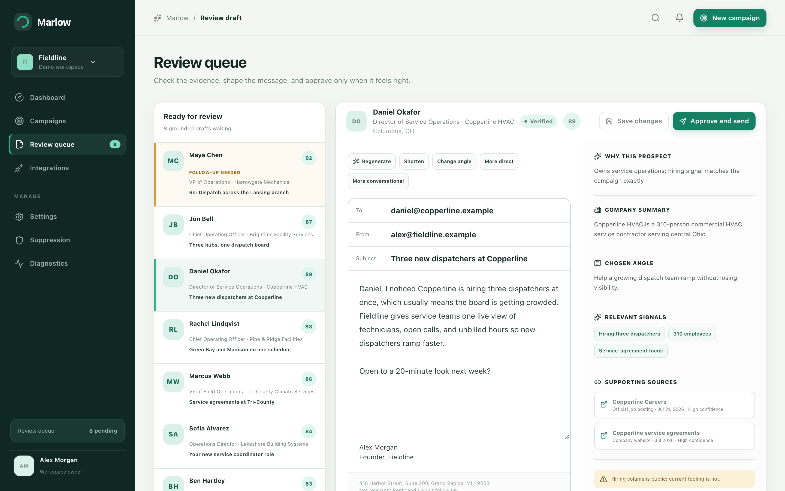
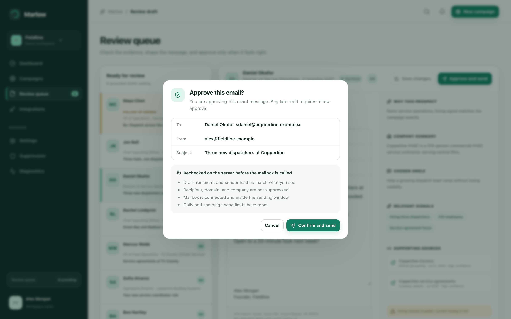
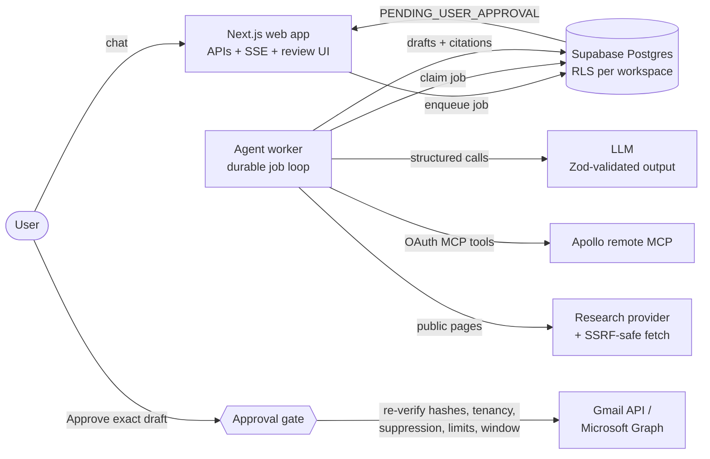

# Marlow

**An AI outbound agent that does the prospecting work and leaves the sending decision to a human.**



You describe your company, offer, and market in a chat. Marlow turns that into a structured ideal customer profile, finds matching companies and people through **Apollo's official remote MCP server**, researches each lead from public sources, and writes a short, cited email for each one. Every email lands in a review queue. **The model has no way to send email.** A message goes out only after a person approves that exact draft, and the server re-checks it before any mailbox is called.

> Demo mode runs locally with no API keys: `pnpm install && pnpm demo` opens http://localhost:4107 with a fictional workspace. See [Demo mode](#demo-mode).

## Features

- **Discovery chat to campaign profile.** A conversational intake asks one question at a time, reads your website, and produces a Zod-validated `CampaignProfile` (offer, target accounts, personas, buying signals, disqualifiers, limits). A campaign can't start until the profile is complete.
- **Lead search through Apollo MCP.** OAuth 2.1 + PKCE against `https://mcp.apollo.io/mcp`, typed tool adapters, paginated account and people search, deterministic qualification, deduplication, suppression checks, and a per-campaign Apollo credit budget.
- **Grounded research.** Official pages, careers posts, and press releases via Tavily or search grounding, fetched through an SSRF-safe retriever. Every claim keeps a URL. Page text is wrapped as untrusted data so it can't instruct the agent.
- **Review queue.** For each draft you see why the prospect was picked, the angle, the signals, cited sources, and what the research _couldn't_ confirm. You can edit, regenerate (shorter, more direct, different angle), skip, block a person or company, or report bad research.
- **Exact-draft approval.** Approving creates a short-lived signed approval tied to hashes of the body, subject, recipient, and sender. Any edit invalidates it.
- **Gmail and Microsoft 365 sending.** Sends go through the user's own mailbox, with their imported signature and a compliance footer. Quiet hours, allowed days, and daily limits are enforced.
- **Reply-aware follow-ups.** Seven days after a send, Marlow checks for a reply. If there's none, it drafts one follow-up and flags it in the queue. It never sends the follow-up automatically.
- **Live progress.** The worker streams progress events to the UI over SSE.



## Architecture



The browser only talks to authenticated application APIs. Long prospecting runs happen in `apps/agent-worker`, never inside a web request.

```text
apps/
  web/            Next.js control plane: authenticated APIs, SSE, review UI
  agent-worker/   persistent Postgres job worker
packages/
  agent/          discovery, orchestration, tool policy, scoring, approval gate
  apollo/         Apollo remote-MCP adapter, OAuth/PKCE, mock provider
  email/          Gmail + Microsoft OAuth, MIME building, sending, reply checks
  research/       Tavily/search grounding and SSRF-safe public retrieval
  database/       Supabase repository, AES-256-GCM credential encryption, job claims
  shared/         Zod contracts, statuses, errors, sending-window logic
  ui/             UI primitives
  config/         runtime environment validation
supabase/         migrations (schema, RLS, RPCs), seed, SQL tests
```

## How the AI and MCP pieces work, and the guardrails

**The loop.** The worker runs `perceive -> decide -> authorize -> call -> validate -> persist -> reassess`. Every model response is parsed with Zod before it's used. Malformed output is retried or recovered, never trusted.

**Tool policy.** Every tool, including each Apollo MCP tool, is registered in a `ToolPolicyRegistry` with `readOnly`, `creditConsuming`, `externalSideEffect`, `sendCapable`, and `requiresApproval` flags. The registry:

- denies unknown tools
- denies enrichment once the credit budget is spent
- denies mutations on paused campaigns
- denies **every** send-capable tool unless the caller is the `approval-gate` actor

The model and the worker never hold that capability ([`packages/agent/src/policy.ts`](packages/agent/src/policy.ts)). Apollo's own send tool is registered as send-capable, so the agent can't reach it either.

**Why the model can't send.** Sending is not a tool in the agent loop. It's a separate HTTP action (`POST /api/drafts/:id/approve-and-send`) that only a signed-in user can trigger, protected by CSRF checks and an idempotency key. The approval gate ([`packages/agent/src/approval.ts`](packages/agent/src/approval.ts)) recomputes the content hashes and re-checks all of the following before the mailbox is called:

- tenancy and recipient
- sender, signature, and compliance footer
- mailbox connection
- suppression list
- campaign state
- daily limits and the sending window

A replayed request returns the original result instead of sending twice.

**Evidence over flair.** Writing only sees verified claims. When evidence is missing, the score is low, or a separate quality review fails, the draft is skipped rather than given invented personalization.

**Models.** Model calls go through the OpenAI SDK pointed at a configurable OpenAI-compatible endpoint. The current production configuration targets Meta's model API. Discovery, writing, and quality review all use structured outputs.

## Demo mode

```bash
pnpm install
pnpm demo        # http://localhost:4107
```

Demo mode (`DEMO_MODE=true MOCK_INTEGRATIONS=true`) needs no keys or database. It serves a deterministic, fictional workspace for "Fieldline", an imaginary dispatch-software company:

- an ideal customer profile for Midwest commercial HVAC operations leaders
- 20 fictional leads across 4 campaigns (awaiting approval, sent, replied, researching, skipped)
- 8 drafted emails with cited sources waiting in the approval queue
- a completed discovery chat, plus a follow-up drafted after no reply

Every name, company, and domain is invented. Domains use the reserved `.example` TLD. Apollo, the model, research, and email are replaced by labeled mock adapters, so demo sends are recorded locally and nothing leaves your machine. The production environment validator rejects `MOCK_INTEGRATIONS=true`, and demo mode is disabled when `NODE_ENV=production`.

## Running against real services

Requirements: Node.js 20.9+, pnpm 10+, Docker, Supabase CLI 2.x.

```bash
pnpm install
cp .env.example apps/web/.env.local   # fill in values from `supabase status`
supabase start
pnpm --filter @marlow/web dev
# second terminal, same env exported:
pnpm --filter @marlow/agent-worker dev
```

Real campaigns need an Apollo OAuth client (MCP access), a model API key, Google and/or Microsoft OAuth clients, and a Supabase project. Setup details: [Apollo MCP](docs/apollo-mcp.md), [connected email](docs/email-providers.md), [deployment](docs/deployment.md), [security](docs/security.md), [compliance](docs/compliance.md).

## Tests

```bash
pnpm lint        # ESLint + copy-style check
pnpm typecheck
pnpm test        # Vitest across all packages
pnpm test:e2e    # Playwright against demo mode (desktop + mobile)
pnpm build
supabase db reset && supabase test db   # RLS and follow-up SQL tests
```

There are 36 Vitest files. They cover:

- the tool policy (send denial, credit budgets)
- approval hashing, signing, and replay
- compliance and suppression
- the campaign state machine and scoring
- Apollo MCP response normalization and rate limits
- SSRF-safe fetching
- MIME building
- the sending window and environment validation

The Playwright suite walks the full path from discovery through review and the approval dialog to an exactly-once demo send, then checks the CSP headers and CSRF rejection. CI runs lint, typecheck, tests, and build on every push ([`.github/workflows/ci.yml`](.github/workflows/ci.yml)).

## Status

What's real: the Apollo MCP integration, Gmail and Microsoft sending, reply detection, and the approval gate are implemented and unit-tested. They were built in July 2026, and the commit history shows them being adjusted against live Apollo MCP responses (rate limits, paid-search responses, current tool names). What isn't: there is no public hosted deployment, and the screenshots come from demo mode with fictional data. Deploy target: `apps/web` on Vercel, `apps/agent-worker` on Railway or any container host, Supabase for Auth and Postgres.

## Stack

TypeScript, pnpm + Turborepo, Next.js 16 / React 19, Supabase (Postgres, Auth, RLS), `@modelcontextprotocol/sdk`, OpenAI SDK, Zod, Vitest, Playwright, GitHub Actions.
