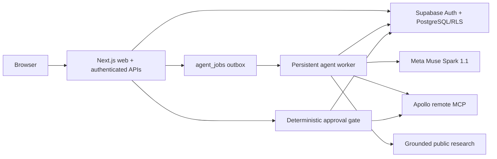

# Architecture

## Boundaries

Marlow separates orchestration from side effects:

Frontend components contain presentation state, not campaign reasoning. Server packages expose typed provider interfaces. Production provider selection is explicit: `MuseSparkProvider`, `ApolloMcpProvider`, and `MetaSearchGroundingProvider`. Mocks require environment configuration and cannot silently replace a failed provider.

## Request and workflow paths

1. Supabase Auth establishes an HTTP-only session. Server routes resolve one organization membership and RLS enforces the same boundary in PostgreSQL.
2. Discovery messages are persisted. Muse Spark returns a schema-validated turn and, when ready, a complete `CampaignProfile` version.
3. Starting a campaign creates an `agent_run` and an `agent_job` in PostgreSQL.
4. The worker claims jobs with `FOR UPDATE SKIP LOCKED`, heartbeats them, enforces time/tool/credit limits, and persists every workflow transition.
5. Search results are deterministically deduplicated and suppressed before enrichment. Research claims store URL, retrieval time, confidence, and source type.
6. Only prospects above the minimum score with supported claims reach writing and independent quality review.
7. Pending drafts appear in the review queue. SSE resumes from `Last-Event-ID` and contains public activity summaries, never hidden reasoning.
8. A direct approval click reserves a unique send, hashes the exact draft, and performs a final deterministic check before Apollo. Ambiguous delivery is not retried automatically.

## Data model

The first migration creates 29 normalized public tables, including all requested organization, membership, integration, campaign, agent, prospect, research, scoring, draft, approval, send, suppression, credit, and audit entities plus durable jobs and rate limits. Every tenant-owned record includes `organization_id`; unique and partial indexes enforce key deduplication and active-draft invariants.

The second migration creates a default organization, owner membership, and user profile on new Supabase Auth users. The third applies explicit API grants and makes audit evidence append-only for application roles. `supabase/seed.sql` provides non-send-capable demo records.

## Durability

- Jobs are PostgreSQL rows with attempt counts, backoff timestamps, locks, and heartbeats.
- Campaign transitions are persisted before outward progress is shown.
- Approval and send reservation is a security-definer PostgreSQL transaction.
- Apollo idempotency keys are unique per organization and sent through the typed adapter.
- A timeout after Apollo invocation becomes `DELIVERY_UNKNOWN`; automated retry is disabled to avoid duplicate mail.
